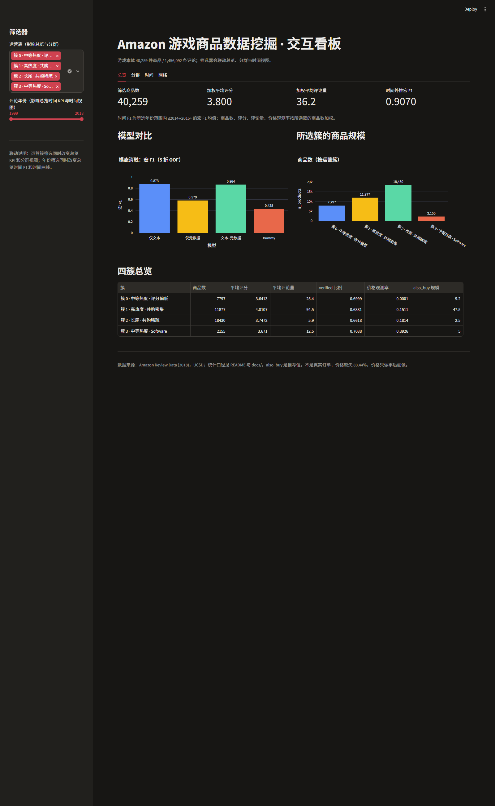
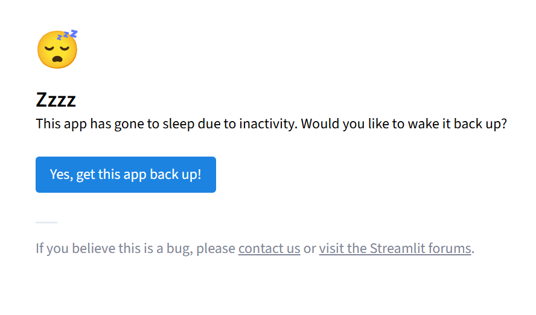

# 交互式业务看板运行说明

## 1. 用途与验收点

看板用 Streamlit + Plotly 实现，入口为 `src/dashboard_app.py`。它覆盖项目验收中的“可交互仪表盘”要求：

- 不少于 3 个视图：实际 4 个，总览、分群、时间、网络。
- 至少 2 个视图联动筛选：实际 2 个筛选器。
- 运营簇多选：联动总览 KPI 与分群视图。
- 评论年份滑块：联动总览的时间外推 KPI 与时间曲线。

看板只读取 `results/tables/` 下的 JSON 汇总，不读取原始 parquet，也不重新训练模型。



## 2. 前置条件

在仓库根目录执行，使用项目环境：

```powershell
cd amazon-games-mining
conda activate amazon-games
```

依赖已固定在 `requirements-dashboard.txt`：

```text
streamlit==1.67.0
plotly==7.1.0
```

首次运行或换机时安装：

```powershell
pip install -r requirements-dashboard.txt
```

看板需要以下四个汇总文件。正常仓库中已存在；若被清理，按对应命令重跑：

| 文件 | 内容 | 生成命令 |
| --- | --- | --- |
| `results/tables/cluster_outcomes.json` | 四簇业务结果 | `python src/cluster_insights.py` |
| `results/tables/classify_time.json` | 时间外推逐年指标 | `python src/classify_time.py --limit 300000` |
| `results/tables/network_compare.json` | 三张网络的边与重叠 | `python src/network_compare.py` |
| `results/tables/classify_ablation.json` | 文本/元数据/合并消融 | `python src/classify_ablation.py` |

四个命令都会写入结果表，不需要重新解析原始数据。

## 3. 启动

```powershell
streamlit run src/dashboard_app.py --server.port 8501
```

启动后终端会显示：

```text
Local URL: http://127.0.0.1:8501
```

浏览器打开 [http://127.0.0.1:8501](http://127.0.0.1:8501) 即可。服务只监听本机回环地址，默认不对局域网开放。

健康检查：

```powershell
curl http://127.0.0.1:8501/_stcore/health
```

返回 `ok` 表示服务已就绪。

## 4. 页面结构与联动

| 视图 | 内容 | 受哪个筛选器影响 |
| --- | --- | --- |
| 总览 | 筛选商品数、加权平均评分、加权平均评论量、时间外推宏 F1；模态消融图；所选簇商品规模；四簇总表 | 运营簇、评论年份 |
| 分群 | 簇间评分/评论量对比、簇画像表、簇规模图 | 运营簇 |
| 时间 | 逐年宏 F1、逐年 PR-AUC、年份明细表 | 评论年份 |
| 网络 | also_buy / also_view / 共同评论人的边数、跨品类比例、Jaccard 重叠 | 无（全量网络） |

联动验收方式：

1. 在侧边栏只保留“簇 1”，总览的“筛选商品数”应从 40,259 变为 11,877，“加权平均评分”变为 4.011。
2. 把“评论年份”从 1999–2018 缩到 2015–2018，总览“时间外推宏 F1”应随年份区间变化，时间视图的曲线和明细表同步收窄。
3. 四个 tab 都能打开，图与表均无报错。

## 5. 自动验收

不打开浏览器也可以做冒烟测试：

```powershell
python -c "from streamlit.testing.v1 import AppTest; at=AppTest.from_file('src/dashboard_app.py', default_timeout=60).run(); print('exceptions', len(at.exception), 'tabs', len(at.tabs), 'plots', len(at.get('plotly_chart')))"
```

期望输出：

```text
exceptions 0 tabs 4 plots 8
```

进一步验证联动：

```powershell
python -c "from streamlit.testing.v1 import AppTest; at=AppTest.from_file('src/dashboard_app.py', default_timeout=60).run(); at.multiselect[0].set_value([1]).run(); print([(m.label, m.value) for m in at.metric]); print('exceptions', len(at.exception))"
```

期望“筛选商品数”为 `11,877`，异常数为 0。

## 6. 停止与换端口

在启动终端按 `Ctrl+C` 停止。

如果端口被占用，换一个端口即可：

```powershell
streamlit run src/dashboard_app.py --server.port 8502
```

需要强制结束本机 8501 端口进程时，先确认 PID：

```powershell
Get-NetTCPConnection -LocalPort 8501 | Select-Object OwningProcess
Stop-Process -Id <PID>
```

## 7. 静态 fallback

没有 Streamlit 环境时，可直接打开：

```text
results/dashboard.html
```

静态版同样提供 4 个视图与 2 个联动筛选（簇多选、年份滑块），并支持 `?tab=overview|clusters|time|network` 直达；它不依赖 Streamlit 服务，适合直接分享。运行时验收以 Streamlit 版为准，用于确认服务与联动均正常。

## 8. 公网访问与部署

当前公网地址（Streamlit Community Cloud 免费公开 app）：[打开 Streamlit 应用](https://amazon-games-mining-dashboard.streamlit.app/)。

该 app 连接仓库 `main` 分支的 `src/dashboard_app.py`，不依赖本机进程。免费公开 app 在约 12 小时无访问后会休眠；页面出现 “This app has gone to sleep due to inactivity” 时，点击 “Yes, get this app back up!” 即可唤醒，数据和代码不会丢失。如需无需唤醒的入口，优先使用静态版。



需要自建时可选：

1. **静态版（无休眠，最稳定）**：把 `results/dashboard.html` 合入 `main`，访问
   [静态看板](https://raw.githack.com/blossom-rt/amazon-games-mining/main/results/dashboard.html)。
2. **Streamlit Community Cloud**：仓库公开后，在 share.streamlit.io 新建 app，分支选 `main` 或 `dev`，主文件填 `src/dashboard_app.py`；Cloud 读取根目录 `requirements.txt`，其中已含 streamlit/plotly。完整步骤见 [streamlit_deploy](streamlit_deploy.md)。
3. **局域网演示**：`streamlit run src/dashboard_app.py --server.address 0.0.0.0 --server.port 8501`，同一网络访问 `http://<本机IP>:8501`。

## 9. 常见问题

**`ModuleNotFoundError: No module named 'streamlit'`**

没有激活项目环境，或没有安装看板依赖：

```powershell
conda activate amazon-games
pip install -r requirements-dashboard.txt
```

**`Port 8501 is already in use`**

换端口 `--server.port 8502`，或按第 6 节结束旧进程。

**页面能打开但提示缺文件**

看板只读 `results/tables/` 的四个 JSON。按第 2 节的表补跑对应脚本；不需要重跑全量七步。

**页面空白或一直转圈**

先访问 `/_stcore/health` 确认服务；若返回 `ok`，刷新浏览器。浏览器控制台若显示 WebSocket 连接失败，检查本机代理是否拦截了 `127.0.0.1:8501`。

## 10. 相关文件

| 文件 | 作用 |
| --- | --- |
| `src/dashboard_app.py` | 看板入口，4 视图与 2 个联动筛选 |
| `requirements-dashboard.txt` | Streamlit、Plotly 固定版本 |
| `src/build_static_dashboard.py` | 生成静态 `results/dashboard.html` |
| `results/tables/cluster_outcomes.json` 等 | 看板数据源 |
| `docs/assets/dashboard_overview.png` | 本说明中的看板截图 |
| `docs/streamlit_deploy.md` | Streamlit Community Cloud 部署步骤 |
