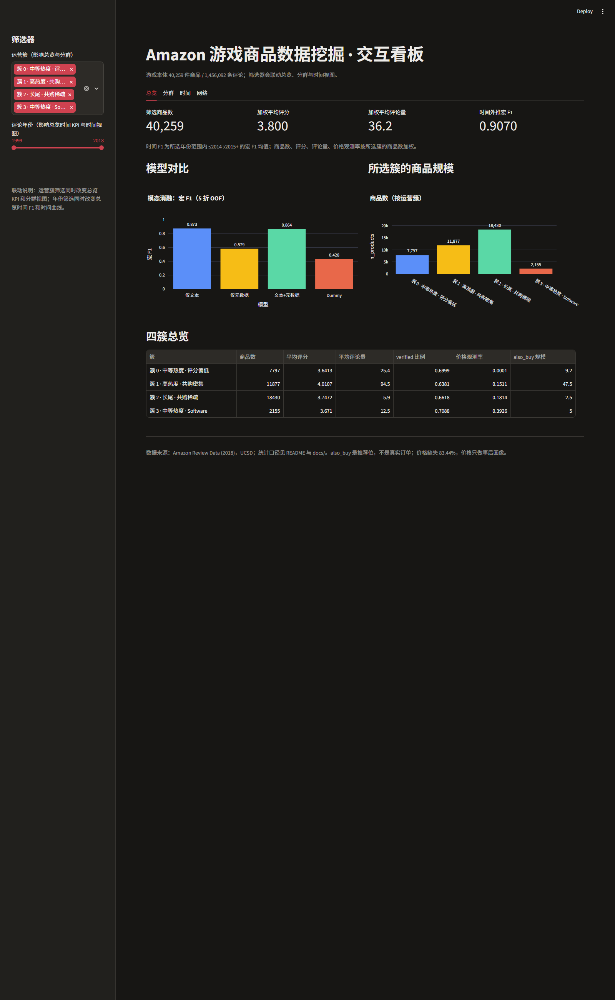
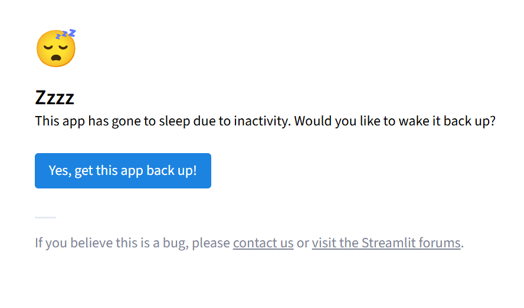

# Interactive Business Dashboard Guide

## 1. Purpose and Acceptance Criteria

The dashboard is built with Streamlit + Plotly; the entry point is `src/dashboard_app.py`. It covers the "interactive dashboard" requirement in project acceptance:

- At least 3 views: 4 in practice — overview, clusters, time, network.
- At least 2 views with linked filters: 2 filters in practice.
- Operational cluster multi-select: links the overview KPIs and the cluster view.
- Review year slider: links the overview's time-extrapolation KPIs and the time curves.

The dashboard only reads the JSON summaries under `results/tables/`. It does not read the raw parquet and does not retrain models.



## 2. Prerequisites

Run from the repository root using the project environment:

```powershell
cd amazon-games-mining
conda activate amazon-games
```

Dependencies are pinned in `requirements-dashboard.txt`:

```text
streamlit==1.67.0
plotly==7.1.0
```

Install on first run or on a new machine:

```powershell
pip install -r requirements-dashboard.txt
```

The dashboard needs the following four summary files. They are present in a normal checkout; if they have been cleaned up, rerun the corresponding commands:

| File | Content | Generation command |
| --- | --- | --- |
| `results/tables/cluster_outcomes.json` | Business outcomes for the four clusters | `python src/cluster_insights.py` |
| `results/tables/classify_time.json` | Year-by-year metrics for time extrapolation | `python src/classify_time.py --limit 300000` |
| `results/tables/network_compare.json` | Edges and overlap for the three networks | `python src/network_compare.py` |
| `results/tables/classify_ablation.json` | Text / metadata / combined ablation | `python src/classify_ablation.py` |

All four commands write to the results tables and do not require re-parsing the raw data.

## 3. Launch

```powershell
streamlit run src/dashboard_app.py --server.port 8501
```

After startup the terminal shows:

```text
Local URL: http://127.0.0.1:8501
```

Open [http://127.0.0.1:8501](http://127.0.0.1:8501) in a browser. The server listens only on the local loopback address and is not exposed to the local network by default.

Health check:

```powershell
curl http://127.0.0.1:8501/_stcore/health
```

A response of `ok` means the service is ready.

## 4. Page Structure and Linked Filters

| View | Content | Affected by which filter |
| --- | --- | --- |
| Overview | Products filtered, weighted average rating, weighted average review count, time-extrapolation macro F1; modality ablation chart; product scale of the selected clusters; summary table of the four clusters | Operational cluster, review year |
| Clusters | Rating / review count comparison across clusters, cluster profile table, cluster size chart | Operational cluster |
| Time | Year-by-year macro F1, year-by-year PR-AUC, year detail table | Review year |
| Network | Edge counts for also_buy / also_view / shared reviewers, cross-category share, Jaccard overlap | None (full network) |

How to verify the linked filters:

1. Keep only "Cluster 1" in the sidebar. The overview's "Products filtered" should change from 40,259 to 11,877, and "Weighted average rating" should become 4.011.
2. Narrow "Review year" from 1999–2018 to 2015–2018. The overview's "Time-extrapolation macro F1" should change with the year range, and the curves and detail table in the time view should narrow accordingly.
3. All four tabs should open, and every chart and table should load without errors.

## 5. Automated Acceptance

You can run a smoke test without opening a browser:

```powershell
python -c "from streamlit.testing.v1 import AppTest; at=AppTest.from_file('src/dashboard_app.py', default_timeout=60).run(); print('exceptions', len(at.exception), 'tabs', len(at.tabs), 'plots', len(at.get('plotly_chart')))"
```

Expected output:

```text
exceptions 0 tabs 4 plots 8
```

To verify the linked filters further:

```powershell
python -c "from streamlit.testing.v1 import AppTest; at=AppTest.from_file('src/dashboard_app.py', default_timeout=60).run(); at.multiselect[0].set_value([1]).run(); print([(m.label, m.value) for m in at.metric]); print('exceptions', len(at.exception))"
```

"Products filtered" should be `11,877` and the exception count should be 0.

## 6. Stopping and Changing the Port

Press `Ctrl+C` in the terminal where the app was started.

If the port is already in use, switch to another one:

```powershell
streamlit run src/dashboard_app.py --server.port 8502
```

To force-kill the process holding port 8501 on this machine, confirm the PID first:

```powershell
Get-NetTCPConnection -LocalPort 8501 | Select-Object OwningProcess
Stop-Process -Id <PID>
```

## 7. Static Fallback

Without a Streamlit environment you can open:

```text
results/dashboard.html
```

The static version also provides 4 views and 2 linked filters (cluster multi-select, year slider), and supports direct navigation via `?tab=overview|clusters|time|network`. It does not depend on a Streamlit service and is convenient to share directly. Runtime acceptance uses the Streamlit version, which confirms that both the service and the linked filters work.

## 8. Public Access and Deployment

Current public URL (Streamlit Community Cloud free public app): [Open the Streamlit app](https://amazon-games-mining-dashboard.streamlit.app/).

The app runs `src/dashboard_app.py` from the repository's `main` branch and does not depend on a local process. A free public app sleeps after about 12 hours without traffic; when the page shows "This app has gone to sleep due to inactivity", click "Yes, get this app back up!" to wake it. No data or code is lost. If you need an entry point that never has to be woken, prefer the static version.



Options for self-hosting:

1. **Static version (no sleep, most stable)**: merge `results/dashboard.html` into `main` and open the
   [static dashboard](https://raw.githack.com/blossom-rt/amazon-games-mining/main/results/dashboard.html).
2. **Streamlit Community Cloud**: once the repository is public, create a new app at share.streamlit.io, select `main` or `dev` as the branch, and set `src/dashboard_app.py` as the main file. Cloud reads `requirements.txt` at the repository root, which already includes streamlit/plotly. Full steps are in [streamlit_deploy](./streamlit_deploy.md).
3. **LAN demo**: `streamlit run src/dashboard_app.py --server.address 0.0.0.0 --server.port 8501`, then access `http://<local IP>:8501` from the same network.

## 9. Common Issues

**`ModuleNotFoundError: No module named 'streamlit'`**

The project environment is not active, or the dashboard dependencies are not installed:

```powershell
conda activate amazon-games
pip install -r requirements-dashboard.txt
```

**`Port 8501 is already in use`**

Use a different port with `--server.port 8502`, or stop the old process as described in section 6.

**The page opens but reports missing files**

The dashboard reads only the four JSON files under `results/tables/`. Rerun the corresponding scripts from the table in section 2; you do not need to rerun all seven pipeline steps.

**The page is blank or keeps spinning**

First request `/_stcore/health` to check the service; if it returns `ok`, refresh the browser. If the browser console reports a failed WebSocket connection, check whether a local proxy is intercepting `127.0.0.1:8501`.

## 10. Related Files

| File | Role |
| --- | --- |
| `src/dashboard_app.py` | Dashboard entry point, 4 views and 2 linked filters |
| `requirements-dashboard.txt` | Pinned versions of Streamlit and Plotly |
| `src/build_static_dashboard.py` | Builds the static `results/dashboard.html` |
| `results/tables/cluster_outcomes.json` and the other JSON files | Dashboard data sources |
| `docs/assets/dashboard_overview.png` | Dashboard screenshot used in this guide |
| `docs/streamlit_deploy.md` | Streamlit Community Cloud deployment steps |
